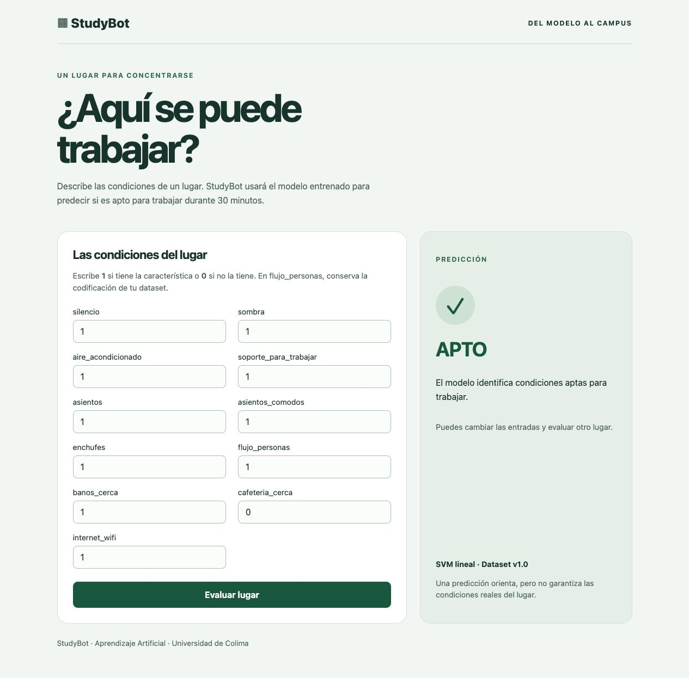
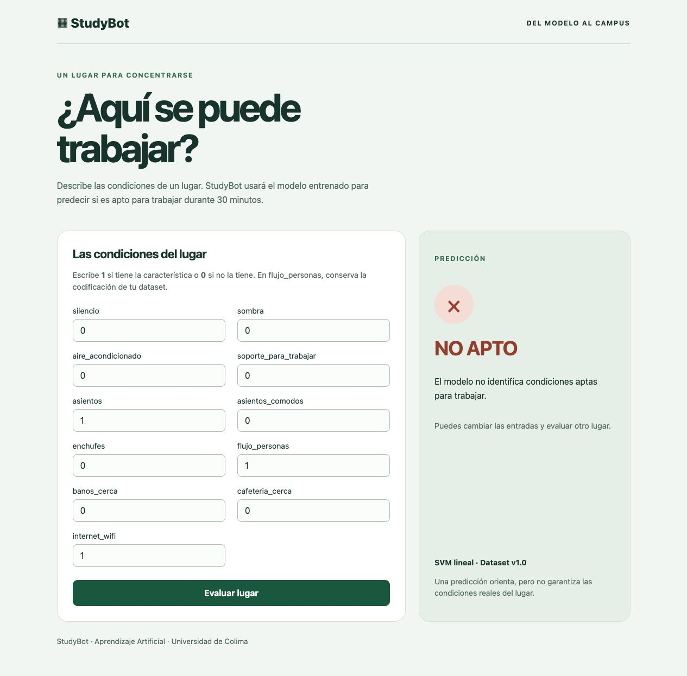
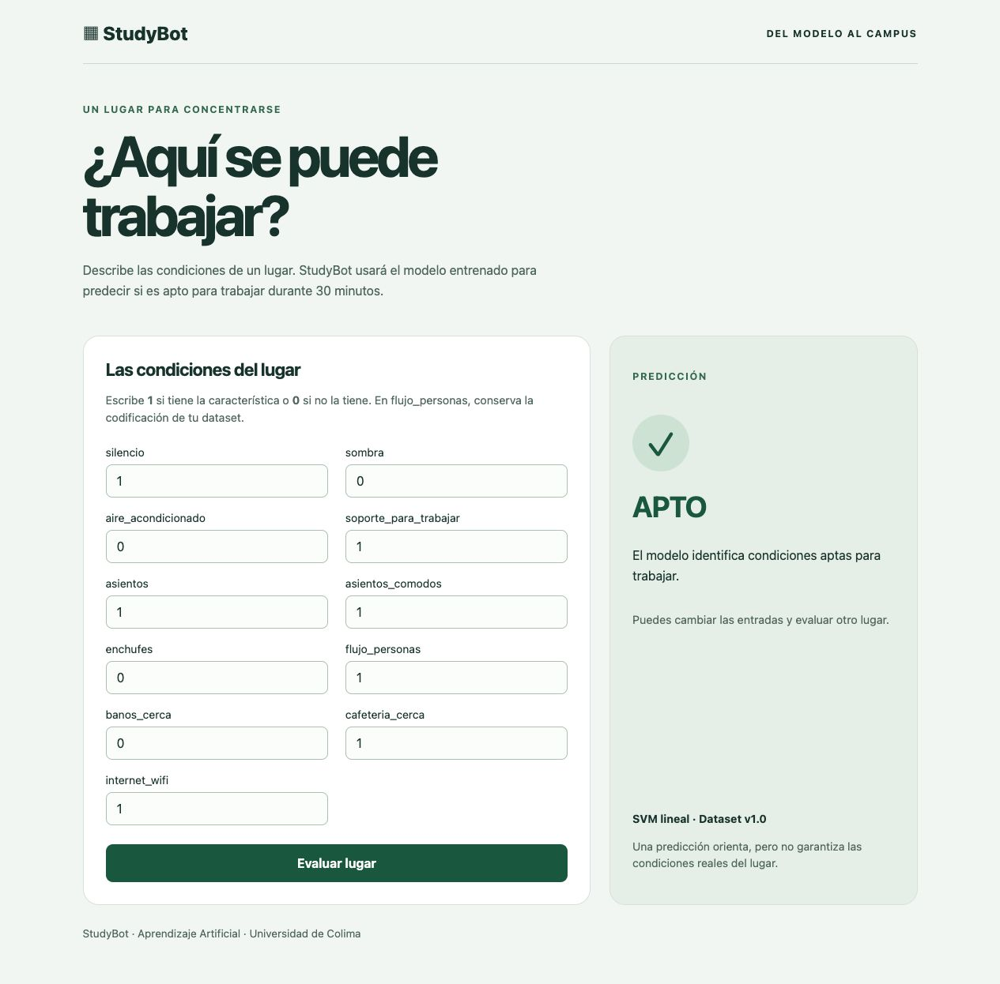

# StudyBot: del modelo a una aplicación Flask

Aplicación de la tercera entrega de **Aprendizaje Artificial 2026**, Universidad de Colima. Equipo 4: Francisco Javier Zuñiga Milanez y Hugo Rafael Preciado Marquez. Profesor: Pedro Cesar Santana Mancilla.

El formulario utiliza el **SVM lineal** de la segunda entrega para clasificar lugares como **APTO / NO APTO** para trabajar durante 30 minutos. Mantiene las 11 variables del Dataset v1.0, sus nombres, orden y valores binarios. No agrega temperatura ni ruido.

## Ejecutar localmente

Requisito: **Python 3.12** (versión usada para verificar la entrega).

```bash
git clone --branch studybot-flask https://github.com/Noctder/knn-lugares-aptos-svm.git
cd knn-lugares-aptos-svm
python3.12 -m venv .venv
source .venv/bin/activate
python -m pip install -r requirements.txt
python app.py
```

En Windows, usa `py -3.12 -m venv .venv` y `.venv\Scripts\activate` para crear y activar el entorno.

Abre **http://127.0.0.1:5000**. Completa todos los campos con `0` o `1` y pulsa **Evaluar lugar**. Detén el servidor con Ctrl+C. Para volver a iniciarlo, activa el entorno y ejecuta `python app.py`. Si el puerto está ocupado: `python -m flask --app app run --port 5001`.

**No necesitas ejecutar el notebook, entrenar ni descargar datos de Kaggle para usar la aplicación.** El archivo `studybot_model.joblib` está incluido. Mantén las versiones indicadas al cargarlo y utiliza únicamente artefactos joblib de confianza.

## Variables y flujo de predicción

Las columnas, en el orden de entrenamiento, son:

```text
silencio, sombra, aire_acondicionado, soporte_para_trabajar,
asientos, asientos_comodos, enchufes, flujo_personas,
banos_cerca, cafeteria_cerca, internet_wifi
```

Son las mismas columnas que obtiene el notebook al excluir `Lugar` y `Target`. `1` indica presencia y `0` ausencia; se conserva la codificación original de `flujo_personas`, sin invertirla. `Target`: 1 = APTO, 0 = NO APTO.

1. Al importar `app.py`, `load_model()` llama a `joblib.load()` una sola vez. Verifica las columnas y clases del artefacto.
2. El navegador envía un POST `/` con los nombres de los inputs HTML. Flask los lee desde `request.form`.
3. `input_frame()` exige valores numéricos finitos 0/1 en todas las columnas. Construye un DataFrame con los nombres y el orden originales. Los errores devuelven HTTP 400 y un mensaje en pantalla, conservando las entradas.
4. `predict_place(values, model)` llama a `model.predict()` y traduce 0/1 a NO APTO/APTO. Jinja muestra el resultado.

No hay `fit()` ni reglas manuales de clasificación en el flujo de inferencia. No se aplicó escalado, imputación ni selección de características en la segunda entrega: todas las variables ya eran binarias. Por ello se guarda el SVC completo sin añadir un preprocesamiento nuevo.

## Procedencia del modelo y exportación

El repositorio original incluía el entrenamiento en `Proyecto_InteligenciaArtificial (1).ipynb`, pero **no contenía un archivo de modelo entrenado**. Se reconstruyó el artefacto fuera de Flask con el procedimiento original: `SVC(kernel='linear')`, 80/20, `random_state=42`, `stratify=y`, Dataset v1.0 local, sin escalado. Solo se conservaron los nombres en el DataFrame en vez de convertirlo a NumPy; esto no cambia los valores ni el entrenamiento.

El script independiente `scripts/export_model.py` documenta esa reconstrucción, guarda el SVM con joblib, lo recarga y verifica que sus predicciones sobre las 13 filas de prueba coincidan con las anteriores al guardado. Los metadatos y hashes están en `evidence/model_metadata.json`. Es una reproducción del procedimiento, no un archivo recuperado de la sesión original del notebook.

Solo si quieres reconstruir el artefacto de forma explícita, fuera del servidor:

```bash
python scripts/export_model.py
```

La copia del dataset proviene de [Dataset v1.0 en Kaggle](https://www.kaggle.com/datasets/schiaffino89/lugares-aptos-para-trabajar). El análisis de la segunda entrega permanece en el notebook y `ENTREGA_ANTERIOR.md`; sus dependencias separadas están en `requirements-notebook.txt`.

## Pruebas y evidencia

```bash
python -m unittest discover -s tests -v
python scripts/record_evidence.py
```

La evidencia de las tres combinaciones incluye todas las entradas, resultado, interpretación y margen del SVM en `evidence/predictions.json`, y la respuesta HTML de cada POST en `evidence/prueba_1.html`, `prueba_2.html` y `prueba_3.html`. El resumen legible está en **`evidence/PRUEBAS.md`**.

Las pruebas comprueban tres predicciones con el artefacto real, campos exactos, entradas ausentes/no numéricas/no finitas/fuera de dominio, ausencia de entrenamiento durante las peticiones y dependencia del resultado respecto a `model.predict()`.

### Capturas de los tres ejemplos

Las capturas muestran las 11 entradas enviadas desde el formulario y el resultado del modelo guardado.

**1. Laboratorio 4 de posgrado — APTO.** Las condiciones coinciden con los patrones aprendidos de lugares aptos.



**2. Bancas verdes centro de idiomas — NO APTO.** El modelo rechaza este lugar con pocos servicios y sin soporte para trabajar.



**3. Atrás de servicios — APTO, caso discutible.** Tiene soporte, pero no sombra, aire acondicionado ni enchufes. Su margen SVM es **0.001286**, muy cercano a la frontera de decisión en cero; no es una probabilidad.



## Respuestas breves

**1. ¿Qué contiene studybot_model.joblib?** El objeto SVC lineal entrenado: vectores de soporte, coeficientes, intercepto, clases, parámetros y nombres de las 11 características. En este caso no contiene un escalador porque no se utilizó en el entrenamiento.

**2. ¿Por qué no ejecutar fit() dentro de la aplicación?** La aplicación debe reutilizar lo que el modelo ya aprendió. Entrenarlo en las peticiones consume recursos, puede cambiar su comportamiento y deja de ser inferencia reproducible con el artefacto entregado.

**3. ¿Por qué usar exactamente el mismo preprocesamiento?** El modelo aprendió con una representación concreta. Cambiar orden, codificación o escala modifica el significado de las entradas y puede producir predicciones incorrectas. Aquí se conservan los 11 valores binarios sin escalado.

**4. ¿Qué diferencia hay entre Flask local y un despliegue real?** Localmente el servidor se ejecuta en tu equipo y se accede mediante localhost. En producción la aplicación funciona en infraestructura accesible a los usuarios, con un servidor WSGI de producción, HTTPS, configuración, supervisión y gestión de recursos; el servidor de desarrollo de Flask no está preparado para ese uso.

## Alcance y uso de IA

El despliegue en la nube es opcional y no forma parte de esta entrega. La exactitud de la prueba original se basa en solo 13 lugares; no demuestra generalización a cualquier campus. El modelo puede discrepar de las etiquetas, especialmente en combinaciones poco representadas.

Se utilizó IA para revisar el repositorio, generar la implementación Flask, el script de exportación, las pruebas y esta documentación. El equipo debe declarar esta participación y revisar el alcance permitido por la consigna. El flujo anterior explica cómo se carga el modelo, se reciben las entradas y se obtiene la predicción.
